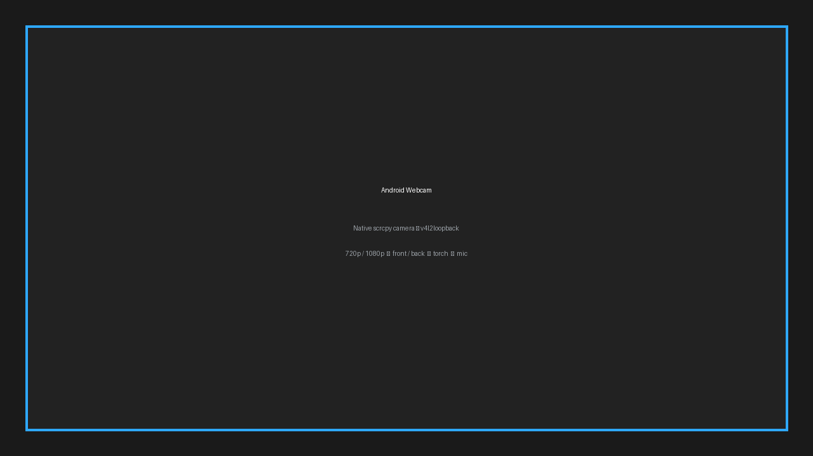

# android-webcam

Use an Android phone as a webcam **and** microphone on your Linux desktop, with no
proprietary app and no vendor daemon. The phone's camera is streamed over `adb` by
`scrcpy-server.jar`, decoded on the host, and published as a real V4L2 device, so
**every** application that opens a webcam — Zoom, OBS, browsers, `ffmpeg` — sees it
as ordinary hardware.

Built for [Omarchy](https://omarchy.sh) / Hyprland, but the Python side is
distro-agnostic.



## What it actually is

```
Redmi Note 8 Pro (Android 13, root)
   |  scrcpy-server.jar - camera, H.264 over Wi-Fi adb on :5555
   v
scrcpy 4.1 (host) --decode--> v4l2loopback --> /dev/video0   (webcam)
                           \--> PipeWire null sink --> default source (mic)
```

There is no APK of ours in the loop. The only thing running on the phone is
scrcpy's own server, pushed over `adb` at launch.

## Requirements

| | |
|---|---|
| Phone | Android 12+ (camera streaming needs it), Wi-Fi, `adb` TCP enabled |
| Host | `scrcpy` 4.1+, `android-tools`, `v4l2loopback-dkms`, `ffmpeg`, Python 3.11+ |
| Optional | root on the phone (KernelSU/termux) for port 5555 at boot and torch at the lowest level |
| No | root on the host, no pip dependencies — `pyproject.toml` declares `dependencies = []` |

## Install

```bash
# 1. host packages (Arch)
sudo pacman -S scrcpy android-tools v4l2loopback-dkms linux-headers ffmpeg
sudo usermod -aG video,adbusers "$USER"      # log out and back in

# 2. v4l2loopback module (one reboot after installing headers)
echo "v4l2loopback" | sudo tee /etc/modules-load.d/v4l2loopback.conf
echo 'options v4l2loopback card_label="Android Webcam" exclusive_caps=0 video_nr=0' \
  | sudo tee /etc/modprobe.d/v4l2loopback.conf

# 3. this project
git clone https://github.com/ishan-parihar/android-webcam.git
cd android-webcam && ./scripts/install.sh
```

`install.sh` installs the `android-webcam` command, loads `v4l2loopback`, adds
your user to `video`/`adbusers`, grants group access to `/dev/video0`, and copies
the Omarchy plugin to `~/.config/omarchy/plugins/ishanp.android-webcam`.

### Omarchy shell integration

The bar widget and panel are a first-party Omarchy plugin:

```bash
omarchy plugin add https://github.com/ishan-parihar/android-webcam.git
omarchy plugin enable ishanp.android-webcam
```

Add it to your bar by editing `~/.config/omarchy/shell.json`, e.g. in
`layout.center`:

```json
["ishanp.android-webcam"]
```

Then reload the shell:

```bash
omarchy-shell shell reload
```

## The phone side

One-time, on the phone:

1. Developer options: **USB debugging** on.
2. Install [Termux](https://f-droid.org/packages/com.termux/) and, if you have
   root, grant it root (KernelSU, or `tsu`).
3. Enable adb-over-Wi-Fi on port 5555. With root, a service script under
   `/data/adb/service.d/` makes this survive reboots; without root, re-run
   `scripts/adb_tcp.sh` after each reboot.

The host discovers the phone and hands over its own adb key on first run — you do
not copy keys by hand.

## Usage

GUI (full controls: camera, resolution, fps, torch, mic, preview, log):

```bash
android-webcam
```

Headless:

```bash
android-webcam --back --1080 --no-window
android-webcam --front --720 --torch --mic
android-webcam --dry-run --back --1080     # print the argv that would run
```

For scripts and the shell panel there are three subcommands:

```bash
android-webcam set torch on                # merge-write config, atomically
android-webcam is-streaming                # prints 'on' or 'off'
android-webcam stop                        # stops the webcam, not the screen mirror
```

### The shell panel

- **Bar icon** — left-click opens the panel, right-click starts/stops. The
  indicator dot is lit only when a live scrcpy *camera* process exists; the
  screen mirror is a different process and never lights it.
- **Panel** — Torch, Mic and Preview toggles; Back/Front and 720p/1080p
  selectors; Start/Stop; Open full GUI. All controls are keyboard reachable.
- Start, Stop and the presets run `setsid -f android-webcam --no-window`, so
  the stream survives the panel closing.
- Camera, resolution and torch are read at launch, so changing them applies to
  the **next** start. The panel says so rather than pretending otherwise.
- Stopping the webcam does not stop an `android-screen` session: both are the
  same executable, so it matches on `--v4l2-sink` in `/proc/<pid>/cmdline`.

See the [panel section](#the-shell-panel) above for plugin-specific details and
troubleshooting.

## Uninstall

```bash
omarchy plugin remove ishanp.android-webcam
./scripts/uninstall.sh
```

Remove `/etc/modules-load.d/v4l2loopback.conf` and
`/etc/modprobe.d/v4l2loopback.conf` if you want the module gone for good.

## Troubleshooting

| Symptom | Cause / fix |
|---|---|
| `/dev/video0` missing | `lsmod \| grep v4l2loopback`; the module needs a reboot after `linux-headers` |
| `Cannot open video device` | re-login after `usermod -aG video`, then `id -nG \| grep video`. Note `install.sh` permissions on `/dev/video0` do **not** survive a reboot; to make them persistent write `KERNEL=="video[0-9]*", SUBSYSTEM=="video4linux", GROUP="video", MODE="0660"` to `/etc/udev/rules.d/99-android-webcam.rules` and run `sudo udevadm control --reload && sudo udevadm trigger` |
| No device on port 5555 | adb-over-Wi-Fi is off, or you moved networks; `adb connect <phone-ip>:5555` |
| Torch does nothing | some cameras expose torch only with root, and not while scrcpy holds the camera |
| Mic silent | the phone mic is forwarded **muted by default**; see `--mic-mute-off` and the echo warning below |
| Camera works, screen is black | some devices need the screen on to keep the camera alive |

> **Mic echo:** forwarding the phone's mic to your speakers can create a feedback
> loop. The default is muted or bound to a null sink. Unmute only with
> headphones or in a quiet room, and accept the risk of howling.

## Development

```bash
./scripts/check-python.sh              # whole suite (10 files, no pytest needed)
python3 tests/test_panel_toggles.py    # a single file
```

The suite is plain `python3` scripts that print `ok`/`FAIL` and exit non-zero on
failure, so it runs the same from a shell, from CI, or from a keybinding.

Layout:

```
src/android_webcam/     app.py (CLI + GTK), backend.py (scrcpy, adb, audio), config.py
Panel.qml BarWidget.qml manifest.json   the Omarchy plugin - these ARE the plugin
android/                a legacy unused APK; the phone runs scrcpy's own server
tests/                  one file per behaviour
```

`Panel.qml`, `BarWidget.qml` and `manifest.json` sit at the repository root
because that is where `omarchy plugin add` looks: it clones the repo and reads
the top-level manifest. There is exactly one copy of each, so the bar widget and
the panel cannot drift apart.

## License

MIT — see [LICENSE](./LICENSE). Depends on scrcpy (GPLv2), v4l2loopback (GPLv2),
ffmpeg and GTK4/libadwaita, which are separate works under their own licences.
